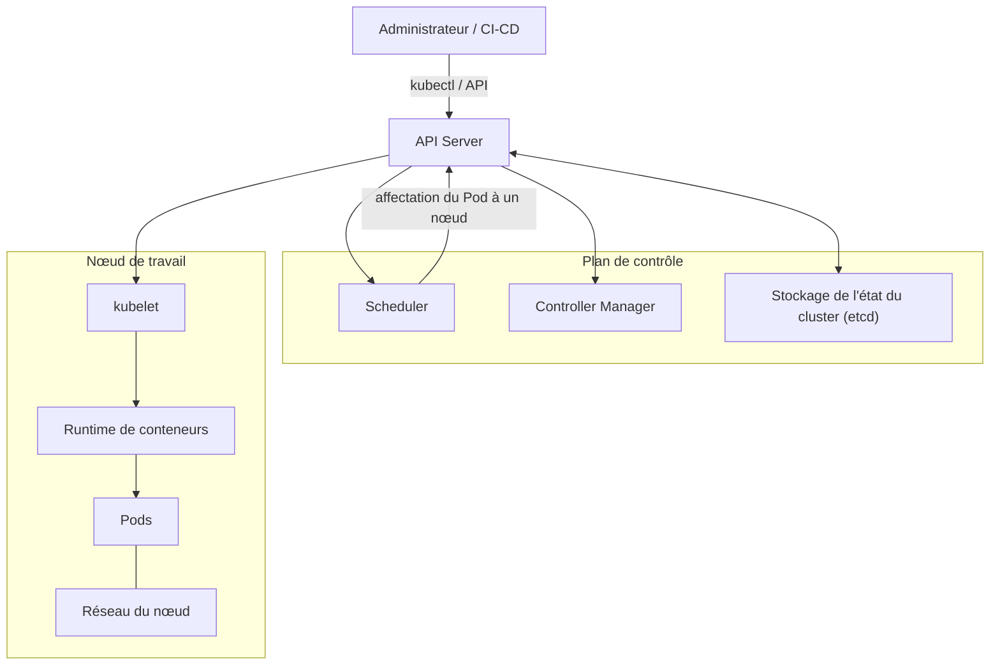
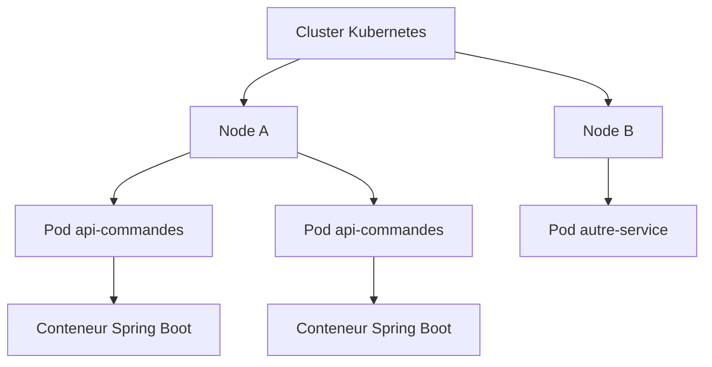
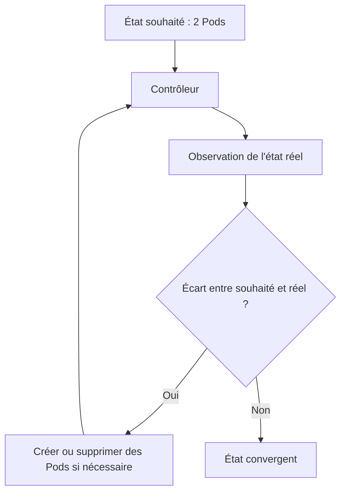
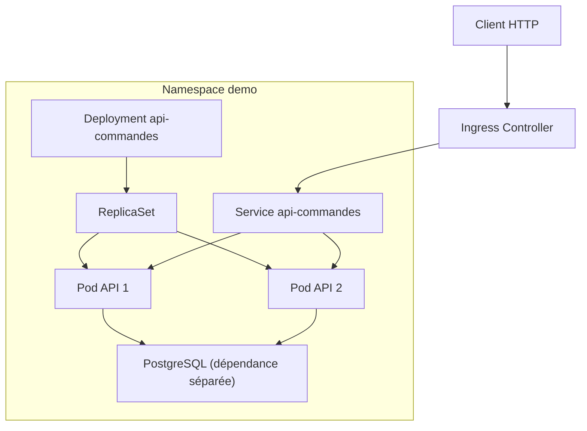
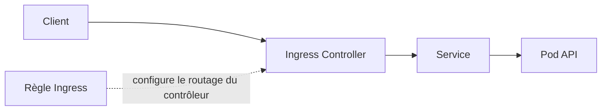

# Kubernetes — Partie 1 : comprendre les fondations avec une API Spring Boot

> **Objectif :** comprendre comment Kubernetes organise un cluster et comment une API Spring Boot fictive y est exécutée.
>
> **Exemple fil rouge :** `api-commandes`, une API qui expose des opérations simples de consultation et de création de commandes.

## Sommaire

1. [Le rôle de Kubernetes](#1-le-rôle-de-kubernetes)
2. [Le cluster Kubernetes](#2-le-cluster-kubernetes)
3. [Les grandes familles de ressources](#3-les-grandes-familles-de-ressources)
4. [Le modèle déclaratif et la réconciliation](#4-le-modèle-déclaratif-et-la-réconciliation)
5. [Les manifests YAML](#5-les-manifests-yaml)
6. [Le Namespace](#6-le-namespace)
7. [Le Pod](#7-le-pod)
8. [Le cycle de vie d'un Pod](#8-le-cycle-de-vie-dun-pod)
9. [Déployer notre API : première vue d'ensemble](#9-déployer-notre-api--première-vue-densemble)
10. [Comment le trafic atteint l'API](#10-comment-le-trafic-atteint-lapi)
11. [Commandes kubectl fondamentales](#11-commandes-kubectl-fondamentales)
12. [Ce qu'il faut retenir](#12-ce-quil-faut-retenir)

---

# 1. Le rôle de Kubernetes

Kubernetes est une plateforme d'orchestration de conteneurs. Son rôle n'est pas simplement de démarrer un conteneur : il automatise le déploiement, le placement, la surveillance et le maintien des applications conteneurisées.

Prenons notre API Spring Boot fictive `api-commandes`.

Sans orchestrateur, il faudrait gérer manuellement plusieurs sujets :

- démarrer le conteneur ;
- choisir la machine sur laquelle il s'exécute ;
- redémarrer l'application lorsqu'elle plante ;
- lancer plusieurs instances pour absorber la charge ;
- répartir le trafic entre ces instances ;
- remplacer progressivement les anciennes versions ;
- injecter la configuration propre à chaque environnement.

Kubernetes fournit des objets et des contrôleurs pour gérer ces responsabilités.

## 1.1 Ce que Kubernetes fait — et ne fait pas

Kubernetes peut notamment :

- planifier des Pods sur les nœuds du cluster ;
- maintenir le nombre de réplicas demandé ;
- redémarrer des conteneurs selon leur politique de redémarrage ;
- fournir un mécanisme de découverte réseau entre Services ;
- monter des volumes ;
- gérer la configuration et les références à des Secrets ;
- réaliser des mises à jour progressives ;
- appliquer des règles de sécurité et de ressources.

En revanche, Kubernetes ne rend pas automatiquement une application robuste. Il faut notamment concevoir correctement :

- les probes de santé ;
- la gestion des connexions et des transactions ;
- la persistance des données ;
- la réplication de la base de données ;
- les sauvegardes ;
- la sécurité des images et des secrets ;
- les limites et demandes de ressources.

**À retenir :** Kubernetes orchestre l'exécution de l'application. Il ne remplace ni la conception de l'application, ni l'administration de ses dépendances.

# 2. Le cluster Kubernetes

Un cluster Kubernetes est constitué d'un plan de contrôle (*control plane*) et d'un ou plusieurs nœuds de travail (*worker nodes*).

## 2.1 Vue générale



Ce schéma est volontairement simplifié. Les composants peuvent être distribués différemment selon le type de cluster et le fournisseur.

## 2.2 Les composants du plan de contrôle

| Composant | Rôle |
|---|---|
| **kube-apiserver** | Point d'entrée de l'API Kubernetes. Il reçoit et valide les requêtes. |
| **etcd** | Stocke de manière persistante l'état du cluster et les objets Kubernetes. |
| **kube-scheduler** | Choisit un nœud pour les Pods qui ne sont pas encore affectés à un nœud. |
| **kube-controller-manager** | Exécute différents contrôleurs qui observent l'état du cluster et agissent pour rapprocher l'état réel de l'état souhaité. |

Dans un cluster managé, le fournisseur peut administrer tout ou partie de ces composants. L'utilisateur ne dispose donc pas nécessairement d'un accès direct aux machines du plan de contrôle.

## 2.3 Les composants d'un nœud de travail

| Composant | Rôle |
|---|---|
| **kubelet** | Agent présent sur le nœud. Il veille à ce que les Pods affectés au nœud soient exécutés conformément à leur spécification. |
| **Container Runtime** | Logiciel qui télécharge les images et exécute les conteneurs, par exemple containerd ou CRI-O. |
| **Composants réseau** | Participent à la connectivité des Pods et des Services. Le détail dépend de l'implémentation réseau du cluster. |

Le scheduler décide *où* placer un Pod. Le kubelet du nœud concerné participe ensuite à son exécution.

## 2.4 Nœud, Pod et conteneur : ne pas les confondre

- **Cluster** : ensemble des ressources Kubernetes.
- **Node** : machine virtuelle ou physique qui fournit la capacité de calcul.
- **Pod** : plus petite unité déployable de Kubernetes.
- **Container** : processus conteneurisé exécuté à l'intérieur d'un Pod.



Un Pod peut contenir un ou plusieurs conteneurs étroitement liés. Dans le cas courant d'une API Spring Boot, le Pod contient généralement un conteneur applicatif. Des conteneurs additionnels peuvent être utilisés pour des besoins précis, par exemple un proxy ou un agent, mais il ne faut pas en ajouter sans raison.

# 3. Les grandes familles de ressources

Kubernetes expose des objets via son API. Le champ `kind` d'un manifeste indique le type d'objet que l'on souhaite créer ou modifier.

Quelques ressources importantes :

| Ressource | Responsabilité principale | Exemple d'usage |
|---|---|---|
| Namespace | Isoler/logiquement regrouper des ressources | Environnement ou équipe |
| Pod | Exécuter un ou plusieurs conteneurs | Instance de l'API |
| Deployment | Déployer une application sans identité persistante par Pod | API Spring Boot |
| ReplicaSet | Maintenir un nombre de Pods correspondant à un selector | Généralement piloté par Deployment |
| Service | Fournir un point d'accès réseau stable à un ensemble de Pods | Accès interne à l'API |
| Ingress | Décrire des règles d'accès HTTP/HTTPS entrant | Exposer l'API par un nom DNS |
| ConfigMap | Stocker de la configuration non sensible | Niveau de logs |
| Secret | Stocker des données sensibles au niveau de l'API Kubernetes | Mot de passe ou jeton |
| PersistentVolumeClaim | Demander un volume persistant | Données d'une base |
| StatefulSet | Gérer des Pods ayant une identité stable | Base de données adaptée à ce modèle |
| Job / CronJob | Exécuter des traitements ponctuels ou planifiés | Import quotidien |

Il existe également des ressources de sécurité et de gouvernance : ServiceAccount, Role, RoleBinding, NetworkPolicy, ResourceQuota, LimitRange, PodDisruptionBudget, etc.

**Attention :** une ressource n'est pas nécessairement un processus. Un Service, par exemple, est un objet de configuration réseau ; il ne démarre pas un conteneur.

# 4. Le modèle déclaratif et la réconciliation

Kubernetes est principalement utilisé de manière déclarative.

On ne décrit pas une suite d'ordres détaillant chaque action technique. On décrit l'état que l'on souhaite obtenir.

Par exemple :

> Je souhaite deux instances de mon API, utilisant telle image, avec tel port et telle configuration.

Kubernetes et ses contrôleurs se chargent ensuite de faire converger l'état observé vers cet état souhaité.

## 4.1 État souhaité et état réel

Supposons que l'on demande deux Pods pour notre API :

```yaml
spec:
  replicas: 2
```

Si un seul Pod fonctionne alors que deux sont attendus, le contrôleur constate un écart et tente de créer un Pod supplémentaire.

Si trois Pods correspondant au selector sont présents alors que deux sont attendus, le contrôleur peut en supprimer un pour revenir à l'état souhaité.



Ce mécanisme est appelé **boucle de réconciliation**.

## 4.2 Déclaratif et impératif

Deux styles de commandes sont souvent rencontrés.

Approche impérative, utile pour une action ponctuelle :

```bash
kubectl create namespace demo
```

Approche déclarative, où l'on décrit l'objet dans un fichier :

```bash
kubectl apply -f namespace.yaml
```

Exemple de fichier `namespace.yaml` :

```yaml
apiVersion: v1
kind: Namespace
metadata:
  name: demo
```

L'approche déclarative est particulièrement importante avec GitOps : les manifests versionnés dans Git décrivent l'état souhaité et un outil tel qu'Argo CD contribue à le synchroniser avec le cluster.

`kubectl apply` ne signifie pas que Kubernetes exécute le fichier comme un script ligne par ligne. Il soumet une configuration d'objet à l'API Kubernetes.

# 5. Les manifests YAML

Un manifeste décrit un objet Kubernetes.

Les champs les plus fréquents sont :

| Champ | Signification |
|---|---|
| `apiVersion` | Groupe et version de l'API Kubernetes utilisée |
| `kind` | Type d'objet |
| `metadata` | Nom, namespace, labels, annotations… |
| `spec` | État souhaité et configuration de l'objet |
| `status` | État observé, renseigné principalement par Kubernetes et ses contrôleurs |

Exemple :

```yaml
apiVersion: v1
kind: Namespace
metadata:
  name: demo
```

Autre exemple, une ressource Pod :

```yaml
apiVersion: v1
kind: Pod
metadata:
  name: api-commandes-test
  namespace: demo
spec:
  containers:
    - name: api
      image: exemple/api-commandes:1.0
      ports:
        - name: http
          containerPort: 8080
```

La propriété `containerPort` documente le port utilisé par le conteneur dans sa spécification. Elle ne publie pas à elle seule ce port sur Internet et ne crée pas de Service.

## 5.1 Vérifier un manifeste avant de l'appliquer

```bash
kubectl apply --dry-run=client -f pod.yaml
kubectl apply -f pod.yaml
```

Selon le besoin, on peut également utiliser un dry-run côté serveur :

```bash
kubectl apply --dry-run=server -f pod.yaml
```

Le dry-run serveur permet de faire valider la requête par l'API du cluster sans persister la modification. Il peut notamment détecter des erreurs de validation qui ne sont pas connues localement.

# 6. Le Namespace

Un Namespace est un mécanisme de regroupement logique de nombreuses ressources Kubernetes.

On peut par exemple séparer les ressources par environnement :

- `dev`
- `recette`
- `prod`

Ou par domaine fonctionnel ou équipe, selon l'organisation.

## 6.1 Créer et examiner un Namespace

Fichier `namespace.yaml` :

```yaml
apiVersion: v1
kind: Namespace
metadata:
  name: demo
```

Commandes :

```bash
kubectl apply -f namespace.yaml
kubectl get namespaces
kubectl describe namespace demo
```

Lister les Pods d'un namespace :

```bash
kubectl get pods -n demo
```

Lister les ressources de tous les namespaces :

```bash
kubectl get pods -A
```

Définir le namespace par défaut du contexte courant :

```bash
kubectl config set-context --current --namespace=demo
```

Cette commande modifie le contexte local kubectl ; elle ne déplace pas les ressources déjà créées.

## 6.2 Ce qu'un Namespace isole — et ce qu'il n'isole pas

Un Namespace permet de regrouper et de nommer séparément de nombreuses ressources namespacées. Il sert aussi de périmètre à des mécanismes comme les quotas et une partie des règles RBAC.

Mais un Namespace n'est pas une frontière de sécurité réseau complète à lui seul :

- il ne crée pas automatiquement une isolation réseau entre Pods ;
- il ne constitue pas une machine ou un cluster séparé ;
- certaines ressources sont globales au cluster et ne sont pas namespacées.

Exemples de ressources généralement namespacées : Pods, Deployments, Services, ConfigMaps, Secrets, PVC.

Exemples de ressources globales au cluster : Nodes, Namespaces, PersistentVolumes, ClusterRoles, CustomResourceDefinitions.

Pour vérifier le périmètre d'une ressource :

```bash
kubectl api-resources
kubectl api-resources --namespaced=true
kubectl api-resources --namespaced=false
```

# 7. Le Pod

Le Pod est la plus petite unité que Kubernetes planifie sur un nœud.

Il représente un environnement d'exécution pour un ou plusieurs conteneurs qui partagent notamment :

- une adresse IP et un espace réseau ;
- des ports réseau au sein du Pod ;
- des volumes déclarés et montés dans le Pod ;
- un cycle de vie commun au niveau du Pod.

Les conteneurs d'un même Pod peuvent communiquer entre eux via `localhost`.

## 7.1 Exemple minimal d'un Pod

```yaml
apiVersion: v1
kind: Pod
metadata:
  name: api-commandes-test
  namespace: demo
  labels:
    app: api-commandes
spec:
  containers:
    - name: api
      image: exemple/api-commandes:1.0
      ports:
        - name: http
          containerPort: 8080
```

Appliquer le manifeste :

```bash
kubectl apply -f pod.yaml
```

Observer le Pod :

```bash
kubectl get pods -n demo
kubectl get pod api-commandes-test -n demo -o wide
kubectl describe pod api-commandes-test -n demo
```

Consulter les logs :

```bash
kubectl logs api-commandes-test -n demo
```

Ouvrir un shell dans le conteneur, si l'image contient un shell :

```bash
kubectl exec -it api-commandes-test -n demo -- sh
```

Si le Pod contient plusieurs conteneurs, préciser celui visé avec `-c` :

```bash
kubectl logs api-commandes-test -n demo -c api
kubectl exec -it api-commandes-test -n demo -c api -- sh
```

## 7.2 Pourquoi ne déploie-t-on généralement pas directement un Pod applicatif ?

Un Pod créé directement est une unité isolée. Si on le supprime, Kubernetes ne sait pas qu'il faut en recréer un autre pour respecter un nombre de réplicas souhaité, puisqu'aucun contrôleur de workload ne porte cette demande.

Pour une API, on utilise généralement un **Deployment**. Celui-ci pilote un ReplicaSet, qui maintient les Pods attendus.

Le Pod seul est utile pour des tests, des diagnostics ou des tâches particulières, mais rarement comme mécanisme de déploiement durable d'une API.

# 8. Le cycle de vie d'un Pod

Un Pod passe par différentes phases. La phase affichée par `kubectl get pods` ne doit pas être confondue avec l'état détaillé de chaque conteneur.

Phases principales :

| Phase | Signification générale |
|---|---|
| `Pending` | Le Pod a été accepté, mais sa mise en place n'est pas terminée. Il peut attendre un nœud, une image ou des ressources. |
| `Running` | Le Pod est lié à un nœud et au moins un conteneur fonctionne ou démarre. Cela ne garantit pas que l'application soit prête à recevoir du trafic. |
| `Succeeded` | Tous les conteneurs se sont terminés avec succès. Fréquent pour un Job. |
| `Failed` | Tous les conteneurs se sont terminés et au moins un a échoué. |
| `Unknown` | L'état du Pod ne peut pas être déterminé. |

Quelques états ou motifs visibles dans la colonne `STATUS` sont des indications pratiques, pas des phases officielles supplémentaires : `CrashLoopBackOff`, `ImagePullBackOff`, `CreateContainerConfigError`, etc.

## 8.1 Quelques problèmes fréquents

| État / symptôme | Pistes de diagnostic |
|---|---|
| `Pending` | Événements, capacité des nœuds, quotas, PVC non lié, contraintes d'ordonnancement |
| `ImagePullBackOff` | Nom/tag de l'image, registre, authentification, connectivité |
| `CrashLoopBackOff` | Logs, configuration, arguments, dépendances, code de sortie |
| `CreateContainerConfigError` | ConfigMap ou Secret absent, clé référencée incorrecte, configuration invalide |
| `Running` mais API inaccessible | Readiness, port applicatif, Service, endpoints, réseau |

Commandes de diagnostic :

```bash
kubectl describe pod <pod> -n demo
kubectl logs <pod> -n demo
kubectl logs <pod> -n demo --previous
kubectl get events -n demo --sort-by=.metadata.creationTimestamp
```

`--previous` permet de consulter les logs de l'instance précédente du conteneur lorsque celle-ci a redémarré et que les logs sont encore disponibles.

## 8.2 Running ne veut pas dire Ready

Il faut distinguer :

- **Running** : le Pod est dans la phase d'exécution ;
- **Ready** : le Pod est considéré prêt à recevoir du trafic selon les conditions de readiness configurées.

Les probes `readinessProbe`, `livenessProbe` et `startupProbe` seront approfondies dans une partie dédiée. Une API peut être en phase `Running` tout en n'étant pas prête à servir des requêtes.

# 9. Déployer notre API : première vue d'ensemble

Notre exemple fonctionnel :

- une API Spring Boot nommée `api-commandes` ;
- un port HTTP applicatif `8080` ;
- deux instances souhaitées ;
- un accès réseau interne stable ;
- une exposition HTTP/HTTPS externe via Ingress ;
- une base de données PostgreSQL, traitée comme une dépendance distincte.

L'architecture cible simplifiée :



Cette architecture est une vue logique. Elle ne signifie pas que PostgreSQL doit nécessairement être installé dans le même Namespace ou dans le même cluster. En production, la base peut être un service managé ou être opérée séparément.

Nous allons ensuite détailler chaque relation :

1. Deployment, ReplicaSet et Pods ;
2. labels et selectors ;
3. Service et EndpointSlices ;
4. Ingress et contrôleur Ingress ;
5. ConfigMap et Secret ;
6. probes et ressources CPU/mémoire ;
7. stockage et choix entre Deployment et StatefulSet ;
8. sécurité, RBAC et réseau ;
9. Helm et GitOps.

# 10. Comment le trafic atteint l'API

Il est important de distinguer les rôles des objets réseau.

- **Pod** : exécute l'API et possède une adresse IP de Pod.
- **Service** : fournit un point d'accès réseau stable vers les Pods sélectionnés.
- **Ingress** : décrit des règles HTTP/HTTPS d'accès entrant, par exemple un nom d'hôte et un chemin.
- **Ingress Controller** : composant réellement chargé de traiter ces règles et de router les requêtes.

Un objet Ingress seul ne suffit donc pas à exposer une application : un contrôleur Ingress doit être installé et configuré dans le cluster.

Vue logique :



Le Service peut également être utilisé directement à l'intérieur du cluster sans passer par Ingress.

# 11. Commandes kubectl fondamentales

## 11.1 Identifier le contexte et le cluster

```bash
kubectl config current-context
kubectl config get-contexts
kubectl cluster-info
kubectl get nodes -o wide
```

Avant toute opération, vérifier le contexte courant est une bonne habitude, surtout lorsqu'on dispose de plusieurs clusters.

## 11.2 Observer les ressources

```bash
kubectl get namespaces
kubectl get all -n demo
kubectl get pods -n demo -o wide
kubectl get pods -n demo --show-labels
kubectl describe pod <pod> -n demo
```

`kubectl get all` est un raccourci pratique, mais il ne liste pas absolument toutes les ressources du namespace. Il faut demander explicitement les types recherchés lorsque c'est nécessaire.

## 11.3 Comprendre la structure d'une ressource

```bash
kubectl explain pod
kubectl explain pod.spec
kubectl explain pod.spec.containers
kubectl explain deployment.spec
```

`kubectl explain` permet de consulter la documentation du schéma connu par le serveur Kubernetes.

## 11.4 Appliquer et supprimer

```bash
kubectl apply -f namespace.yaml
kubectl apply -f pod.yaml
kubectl delete -f pod.yaml
```

La suppression d'un manifeste supprime la ressource correspondante ; elle ne doit pas être utilisée sans comprendre les conséquences, particulièrement pour les ressources avec stockage.

# 12. Ce qu'il faut retenir

1. Un cluster est constitué d'un plan de contrôle et de nœuds de travail.
2. Le plan de contrôle expose l'API Kubernetes, stocke l'état et orchestre les décisions.
3. Un nœud exécute les Pods grâce notamment au kubelet et au runtime de conteneurs.
4. Un Pod est l'unité déployable ; un conteneur est un processus exécuté dans ce Pod.
5. Un Namespace organise les ressources, mais ne fournit pas à lui seul une isolation réseau complète.
6. Un manifeste YAML décrit un objet Kubernetes avec `apiVersion`, `kind`, `metadata` et `spec`.
7. Kubernetes fonctionne selon un modèle déclaratif et des boucles de réconciliation.
8. Pour une API durable, on utilise généralement un Deployment plutôt qu'un Pod créé directement.
9. `Running` ne signifie pas automatiquement `Ready`.
10. Service, Ingress et Ingress Controller ont des rôles différents.

---

## Suite du parcours

La **partie 2** approfondit les relations entre ressources : Deployment → ReplicaSet → Pods, labels/selectors, Services et EndpointSlices, ConfigMap, CRD/Operators, RBAC et StatefulSet.

La suite pratique consistera à construire progressivement les manifests de `api-commandes`, en validant chaque étape avant d'ajouter la suivante.
